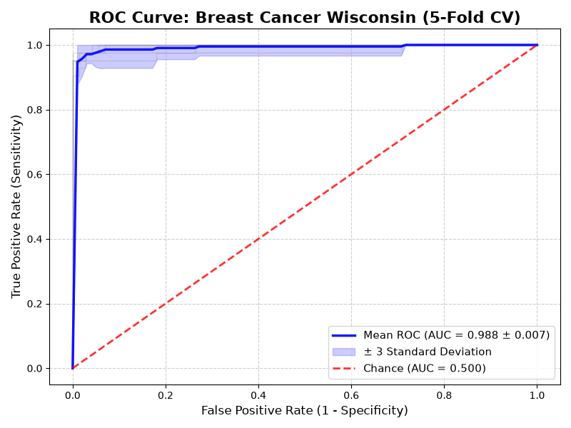

# Phase-Shifted SineNet — Custom Deep Learning Framework in Pure C


A custom supervised Deep Learning architecture implemented from scratch in **pure C** (zero external ML/math library dependencies), orchestrated via a **Python** automation pipeline for stratified $k$-fold cross-validation and performance evaluation.

---

## Theoretical Background: Fourier-like Spectral Predictor

Unlike standard Multilayer Perceptrons (MLPs) that rely purely on monotonic activation functions, **Phase-Shifted SineNet** introduces a trainable **phase-shift parameter ($\phi$)** within periodic sinusoidal functions:

$$f(x) = \sum_{i=1}^{N} w_i \sin(\omega_i x_i + \phi_i)$$

By the trigonometric identity $\sin(\alpha + \phi) = \sin(\alpha)\cos(\phi) + \cos(\alpha)\sin(\phi)$, the introduction of the phase offset $\phi$ enables each neuron to simultaneously modulate both orthogonal harmonic components ($\sin$ and $\cos$). Consequently, the network acts as a **generalized Fourier series predictor**, capable of decomposing and approximating high-frequency functions, periodic signals, and complex non-linear decision boundaries with compact layer topologies.

---

## Key Technical Features

* **Pure C Computational Core:** Forward pass, analytical backpropagation (including phase-shift gradients), and memory management written entirely from scratch using standard C libraries (`stdlib.h`, `math.h`).
* **Custom Optimizers & Regularization:** Native C implementations of **Adam**, **RMSProp**, and **Momentum** optimizers, featuring step-based learning rate decay and validation **Early Stopping** (`patience` control).
* **Compile-Time Metaprogramming:** The Python orchestrator dynamically injects network topology (`N_LAYERS`, node counts) and hyperparameters directly into the C preprocessor via `gcc -O3 -D` macros, enabling static memory layout and compiler-level loop vectorization.

---

## Benchmark Results: Breast Cancer Wisconsin (5-Fold CV)

Evaluated on the **Breast Cancer Wisconsin (Diagnostic)** dataset ($30$ input features, $15$ hidden nodes, $2$ softmax output nodes) using the **Adam** optimizer across a 5-fold stratified cross-validation:

* **Mean ROC-AUC:** $0.988 \pm 0.007$



---

## Quickstart & Demo

### Prerequisites
* **C Compiler:** `gcc` (MinGW on Windows, `build-essential` on Linux)
* **Python 3.8+:** `numpy`, `pandas`, `matplotlib`, `scikit-learn`

### Run the Demo

Clone the repository and launch the automated pipeline:

```bash
# 1. Clone repository
git clone [https://github.com/FbdIkazama/Phase-Shifted-SineNet.git](https://github.com/FbdIkazama/Phase-Shifted-SineNet.git)
cd Phase-Shifted-SineNet

# 2. Install Python dependencies
pip install -r requirements.txt

# 3. Compile C core (-O3) and run 5-Fold Cross-Validation
python demo.py
```

The script compiles `main/bin/src/PhaseShiftSineNet.c` with `-O3` optimization flags, runs the 5-fold training/testing cycle on `main/demo_results/BCancerW.csv`, prints the mean accuracy to the console, and renders the ROC-AUC curve.